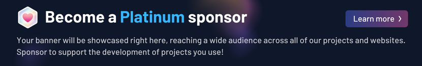
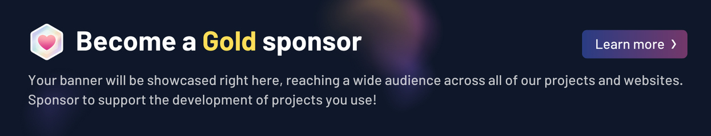
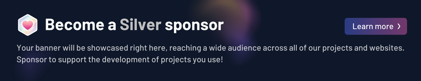

# Sponsors

I want to thank everyone who support BetterTyped. You're are amazing 💖

# Tiers

## Platinum

Placement: Top of page (somewhere above the fold)

<p align="center">
	<a href="https://github.com/sponsors/prc5?tier=platinum">
		<picture>
			
		</picture>
	</a>
</p>

<p align="center">
	<a href="https://github.com/sponsors/prc5?tier=Platinum">
		<picture>
			
		</picture>
	</a>
</p>

## Gold

Placement: Middle of page

<p align="center">
	<a href="https://github.com/sponsors/prc5?tier=Gold">
		<picture>
			
		</picture>
	</a>
</p>

<p align="center">
	<a href="https://github.com/sponsors/prc5?tier=gold">
		<picture>
			
		</picture>
	</a>
</p>

## Silver

Placement: Bottom of page

<p align="center">
	<a href="https://github.com/sponsors/prc5?tier=Silver">
		<picture>
			
		</picture>
	</a>
</p>

<p align="center">
	<a href="https://github.com/sponsors/prc5?tier=Silver">
		<picture>
			
		</picture>
	</a>
</p>

## Other

Placement: End of page

<p align="center">
	<a href="https://github.com/sponsors/prc5">
		
	</a>
</p>

# Feed

Every BetterTyped docs site reads its partners and sponsors from one JSON file. jsDelivr serves it from this repo with
a long cache, and the workflow purges the cache whenever the file changes:

```
https://cdn.jsdelivr.net/gh/prc5/sponsors@main/feed/v1/sponsors.json
```

| Field             | What it holds                                                                                  |
| ----------------- | ---------------------------------------------------------------------------------------------- |
| `partners`        | Live entries from `partners.json`, platinum first. `house` entries fill the slots nobody holds |
| `sponsors`        | Active public GitHub sponsors, highest tier first                                              |
| `pastSponsors`    | Public sponsors whose sponsorship ended. `PAST_TIERS` in the script remembers notable tiers    |
| `privateSponsors` | How many private sponsors there are. They are never named                                      |
| `links`           | Where "Sponsor" and "Become a partner" point                                                   |

The workflow rebuilds the feed every six hours, on every push that touches `partners.json` or `assets/partners`, and
on demand from the Actions tab.

## Adding a partner

1. Put the logo in `assets/partners/` (square, at least 128px, SVG or PNG).
2. Add an entry to `partners.json`. `tier` is `platinum`, `gold`, `silver` or `house`. `projects` is `"all"` or a list
   of site ids (`hyper-fetch`, `docusaurus-docgen`, `react-zoom-pan-pinch`). `github` takes their GitHub login when they also sponsor, so they show as the partner only. `startsAt` and `endsAt` take ISO dates,
   and the feed drops the partner on its own once `endsAt` passes.
3. Push to `main`. The workflow checks the file, rebuilds the feed and purges the CDN.

Run `node --test scripts/` to test the builder, and `SPONSORS_GITHUB_TOKEN=$(gh auth token) node scripts/build-feed.mjs --dry`
to see the feed it would write.
